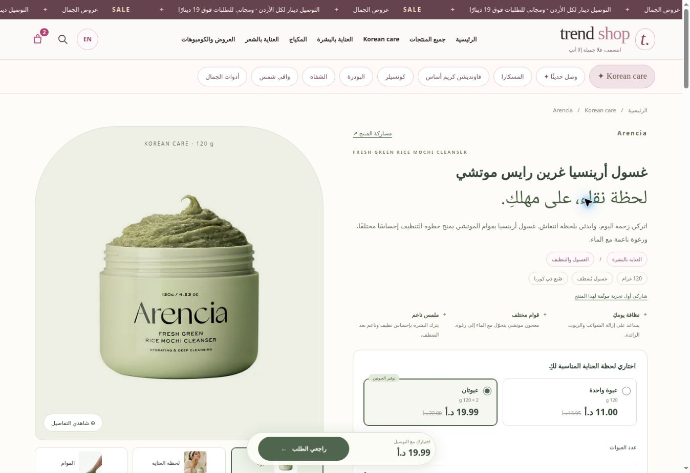

# Arencia product-page pilot — v3.2.0

Published: 4 November 2026. [Arabic product page](https://trendjo.pages.dev/p/TS0098) · [English product page](https://trendjo.pages.dev/p/TS0098?lang=en).

The previous product page put its full narrative and instructions before the purchase controls. TS0098 now has a dedicated, responsive product story: exact-pack hero, promotional application scene, manufacturer texture clip, concise benefits, a single/two-jar selector, delivered price and persistent order button. The one-product scope leaves all other product-page layouts intact.

## Purchase flow

- Single jar: **11 JOD** plus **1 JOD** delivery. Two jars: **19.99 JOD**, free delivery, saving **2.01 JOD** against two current-price singles. The approximately10JOD unit price is explicitly rounded;19.99 is the authoritative pack total.
- The pair is a normal active promotion, not a second inventory SKU. Both browser and order server use the existing shared quotation engine. Selection uses the actual catalog price, active offer and available stock. Repeated opening updates the same quantity, retaining other bag items.
- Quick checkout reuses the existing validator, phone loader, deadlines and idempotency/recovery flow. Email and notes are optional and collapsed. Validation opens their panel if correction is needed and focuses the exact field. Arabic/English digits, international numbers and one-word area addresses remain accepted.
- Native dialog handles focus, keyboard dismissal and restoration. Dismissal is blocked during an active confirmation. Opening focuses the heading rather than summoning the mobile keyboard. WhatsApp assistance stays last and prepares one message with product links and the same bag totals.
- The same single product-specific reviews response drives the top count and review cards. No invented ratings, reviews, results, countdown or inspection/return guarantee was added.

## Content and media

Research used the [manufacturer US product page](https://arencia.us/products/arencia-fresh-green-mochi-cleanser) and [Korean product78](https://arencia.com/product/프레시-그린-클렌저-떡솝-120g/78/category/72/display/1/). The current official package differs from the catalog pack; the existing120g jar stays the hero. Regional ingredient lists and optional-mask timings also differ. Copy therefore uses the common rice/green-tea ingredients and normal lather/rinse directions, deferring full INCI and other uses to the customer’s actual jar.

The new application scene is advertising imagery, labelled as a promotional scene. It is not represented as a customer experience or evidence of results. The manufacturer’s packaging-free texture animation was transcoded to a4.25second H.264 clip; it does not autoplay and loads video data on demand. Community creator clips were excluded. No explicit redistribution licence was found for the manufacturer marketing footage; the source and provenance are recorded.

[Asset provenance, prompt and reversible product-copy snapshot](../data/arencia-pilot-2026-11-04.json) record sources, decisions, hashes and sizes. Two optimized WebP images total178270bytes; the optional video is662993bytes. All three live files matched the local SHA-256 hashes. The main catalog image remains unchanged.

## Verification

The complete suite passed **176/176** checks. After the final unit-price rounding correction, **11/11** targeted product/checkout tests passed again. Tests exercise the real browser module graph, duplicate prevention, stock limits, inactive offers, retained bag/draft, locale switching, optional-email corrections, Arabic/international phone validation, refreshed totals after409 conflicts, uncertain-request retries and repeatable migrations.

Browser QA covered desktop and a390×844phone-sized preview, Arabic/English, gallery/zoom, section navigation, real MP4 playback and the checkout dialog. A simulated preview order succeeded after correcting an invalid number. The preview had no database or secrets, rejected external writes, and did not send a real order, email or WhatsApp message. Production was checked through the product URL, actual active promotion and live confirmation UI without submitting an order. Actual iPhone hardware and keyboard were not available.

| Data | Before | After |
| --- | ---: | ---: |
| All product records |321|321|
| Active approved catalog products |302|302|
| Total stock |7218|7218|
| Orders |13|13|
| Order items |71|71|
| Existing active promotions |5|5|
| Added pair promotion |0|1|

The full live catalog comparison changed only TS0098 content. Every price, reference price, approval, active flag and stock value was preserved; all five existing promotions matched their prior configuration. The copy update and new offer each affected one intended record. Existing database/media bindings, live-order setting and all four secret bindings were retained.

## Rollback and next measurement

The previous source is saved as `backup/v3.1.0-before-arencia-2026-11-04` at46a5eba8eafe442dea461af3674c45abe796a231. Its previous Worker version is0b10dcb3-6a61-4b0c-a09c-c9361f2831dd. Migration0018 is guarded and repeatable; it changes only product description/details and inserts the new promotion if absent. It never resets stock or rewrites historical orders. To undo the content, restore only the copy fields from the provenance snapshot if their current values still match this release, deactivate PROMOARENCIA-PAIR if appropriate, then redeploy the backup source. Preserve any subsequent admin edits and sales.

The pilot is ready for one-product advertising. Conversion or profit improvements have not been measured; compare confirmed/delivered orders and average order value after traffic arrives. Product cost and real fulfilment costs are needed to calculate margin.

