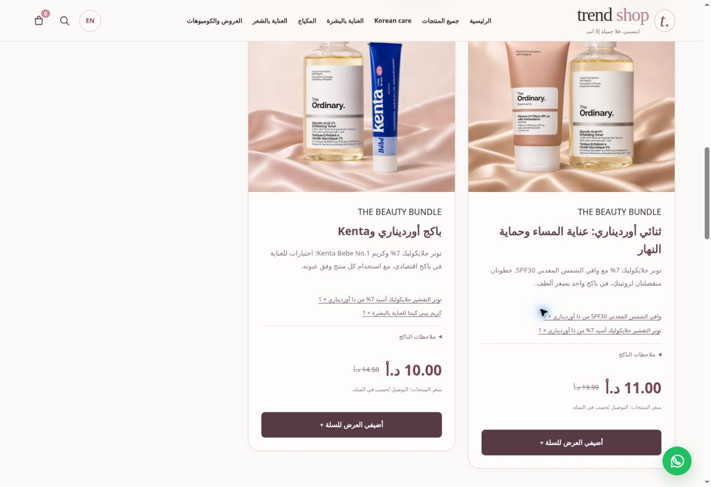

# Trend Shop 3.1.0 — Korean care and beauty bundles

The storefront adds a Korean care collection, sixteen promotional images and five automatically priced offers. The existing Arabic/English storefront, checkout and genuine-purchase review system remain in place.

## Offers

| Contents | Products price after the offer |
| --- | --- |
| The Ordinary Mineral UV Filters SPF30 + Glycolic Acid 7% Toner | 11 JOD |
| The Ordinary Glycolic Acid 7% Toner + Kenta Bebe No.1 Cream | 10 JOD |
| Three pink Maybelline Sky High mascaras | 10 JOD |
| Pink Sky High + Fit Me Luminous Smooth foundation + Super Stay Vinyl Ink | 8 JOD |
| L’Oréal Infallible Fresh Wear powder + original gold Telescopic mascara | 8 JOD |

The pink Maybelline Sky High single-product price is 5 JOD. The Maybelline lip product is the existing **Super Stay Vinyl Ink liquid lipcolour**, accurately labelled; Lifter Gloss is not currently in the catalog. Bundle prices exclude delivery. Delivery remains 1 JOD, free when the final merchandise total exceeds 19 JOD.

Compatible offers combine without spending the same unit twice. The bounded planner evaluates delivery as well as the products total, so applying an offer cannot increase the final amount. Foundation and powder bundles open a tone-selection dialog before any items are added. Each applied offer is separately shown in bag and checkout totals. The server uses the same pricing rules and original product inventory; no independent bundle stock is created. Administrator price edits preserve imagery and English copy while contents match; changing contents discards stale artwork.

## Collections and presentation

The virtual [Korean care collection](https://trendjo.pages.dev/#/shop?collection=korean-care) groups Korean brands across their existing skincare, makeup, body and hair categories. It does not move products out of their original sections. The pre-deployment live catalog contains 105 matching products. The collection is reachable from the main navigation, category navigation, home gateway and filters. Clearing filters restores the full listing and closes the panel.

The wordmark, category gateways and offer cards have a coordinated ivory, blush and plum treatment. Beauty tools and Korean care have new category artwork. The home page features the Sky High, Maybelline and L’Oréal offers. Related product pages link to their available bundles.

Nine new reference-based scenes show fictional adult models using the exact requested products: Huda Beauty eyeshadow, The Ordinary SPF30, The Ordinary toner on the outer thigh, pink Sky High, gold Telescopic, Benefit BADgal BANG, L’Oréal powder, Estée Lauder Double Wear and AXIS-Y eye serum. Five product-only bundle images show their actual contents. Two category images use editorial props. Original packshots remain first in product galleries; lifestyle scenes are labelled promotional. The AXIS-Y scene shows preparation/application, with no invented before/after result.

The sixteen selected images are delivered as thirty optimized WebP files, including thumbnails, totalling **2,000,868 bytes**. Exact prompts, reference paths and generation provenance are in `data/marketing-assets-2026-11-03.json`; product gallery provenance is appended to `data/gallery-provenance.json`. Built-in image generation was used. The new media URL rules accept only the named, hashed campaign patterns; private backup keys and arbitrary storage keys remain inaccessible.

## Email activation pending

`integrations/google-apps-script.gs` now composes Arabic and English in **one customer confirmation email for every provided email address**, independent of shopping language. The subject contains both languages. Optional-email behavior, owner notification and remaining-recipient quota behavior are retained. Tests exercise Arabic, English and unspecified locales, COD and manual CliQ.

**This template has not yet been activated in the live Google Apps Script deployment.** The connected store account was signed out, and the secure browser sign-in request was cancelled. The website release does not change or disable the existing mail bridge. Activation requires updating the existing Apps Script deployment after authorized Google sign-in; its existing script properties and webhook secret must be preserved. No confirmation emails were sent during testing.

## Validation and data protection

165 automated tests passed. New coverage includes every advertised price, repeated three-piece offers, compatible/overlapping bundles, exhaustive comparisons on varied small carts, tone selection, Korean collection/reset, image routes, private-key rejection, campaign edit metadata, bilingual single-email composition and repeatable price/offer migration preserving prior orders and sold inventory.

The isolated browser preview has no production database or mail credentials, and rejects all API writes. Desktop and 390-pixel mobile checks verified offer images, a non-overflowing header, toner gallery selection, English offer/checkout text, tone selections, a three-offer basket at 26 JOD with free delivery, prepared WhatsApp links for all five distinct products, and clearing the Korean filter. No production test order, email or WhatsApp message was sent.

The source backup is `backup/v3.0.0-before-campaign-2026-11-03` at `ab5e6ac60fb27c8da95689955d1d0aaab4db8b2e`. Migration `0017_campaign_offers.sql` changes only the guarded Sky High price/discount and inserts the five named offers; repeating it preserves administrator changes. It never resets stock, order history, existing approvals or other product prices. Rollback must preserve inventory and orders created since the backup.

No fictional customer reviews or verified ratings have been published. The genuine completed-purchase review and moderation flow remains available.

Product-use references: [The Ordinary toner directions](https://theordinary.com/en-us/glycolic-acid-7-exfoliating-toner-100418.html), [The Ordinary body-care discussion](https://theordinary.com/en-jo/blog/what-causes-strawberry-skin.html), [AXIS-Y eye serum](https://www.axis-y.com/products/vegan-collagen-eye-serum).

## Publication check

The website and offers are live at https://trendjo.pages.dev/. Production Worker `0b10dcb3-6a61-4b0c-a09c-c9361f2831dd` receives 100% of traffic. All thirty new media files were fetched and matched the source hashes, and the published app, stylesheet and campaign JSON matched the source bytes. All six guarded migration statements changed one intended row each. The database retained 321 products, 7,218 stock units, 13 orders and 71 historical order-item rows; five offers are active. The only existing-product price change is Sky High from 6.99 to 5 JOD, with its displayed discount adjusted from 30% to 50%.

The production browser confirmed 105 products in Korean care, all five advertised offer prices, seven category gateways, three featured home offers and an empty untouched cart. Google email-template activation remains pending as explained above.

